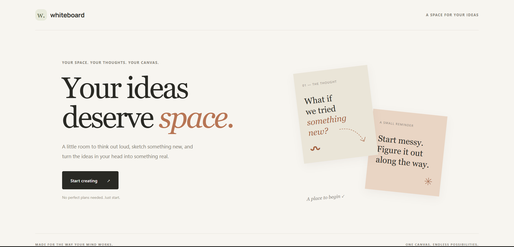
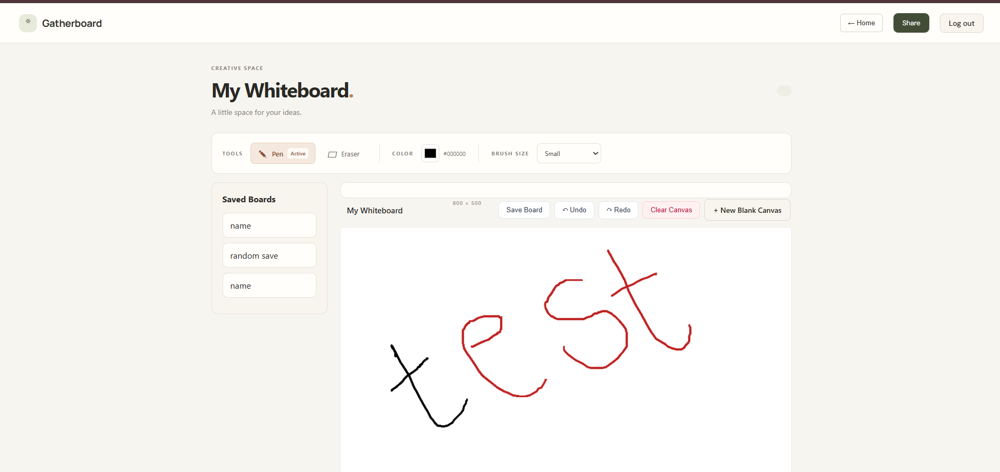
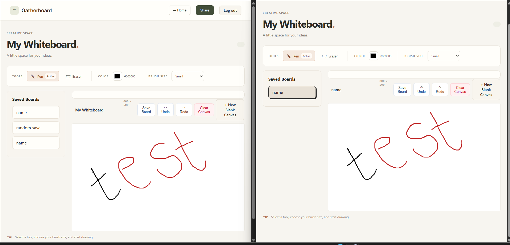

# Gatherboard

### Your ideas deserve space.

Gatherboard is a real-time collaborative whiteboard application that allows users to draw, brainstorm, and share ideas with others.

Users can create personal boards, collaborate with others through shareable links, and see drawing updates in real time.

**Live Demo:** https://gatherboard-delta.vercel.app

---

## Features

- **User Authentication:** Secure registration and login.
- **Personal Whiteboards:** Create and manage individual boards.
- **Interactive Drawing Canvas:** Draw using customizable pen colours and brush sizes.
- **Eraser Tool:** Easily modify your drawings.
- **Undo & Redo:** Reverse or restore drawing actions.
- **Board Persistence:** Save drawings and restore them later.
- **Real-Time Collaboration:** Multiple users can draw on the same board simultaneously.
- **Board Sharing:** Invite collaborators using shareable links or codes.
- **Access Control:** Protect personal boards and manage shared access.

---

## Tech Stack

| Category                | Technology          |
| ----------------------- | ------------------- |
| Frontend                | React, TypeScript   |
| Styling                 | CSS                 |
| Backend                 | Node.js, Express.js |
| Database                | MongoDB Atlas       |
| Real-Time Communication | Socket.IO           |
| Authentication          | JWT                 |
| Frontend Hosting        | Vercel              |
| Backend Hosting         | Render              |

---

## Architecture

Gatherboard follows a client-server architecture.

1. **Frontend:** React provides the interactive user interface and drawing canvas.
2. **Backend:** Express handles authentication, board management, and API requests.
3. **Database:** MongoDB stores user and board information.
4. **Real-Time Communication:** Socket.IO synchronizes drawing activities between connected users.
5. **Authentication:** JWT-based authentication protects user-specific resources.

---

## Getting Started

### Prerequisites

- Node.js
- npm
- MongoDB Atlas account

### 1. Clone the repository

```bash
git clone https://github.com/amruta-deshpande20/collaborative-whiteboard.git
```

### 2. Navigate to the project

```bash
cd collaborative-whiteboard
```

### 3. Install frontend dependencies

```bash
cd client
npm install
```

### 4. Install backend dependencies

```bash
cd ../server
npm install
```

### 5. Configure environment variables

Create the required `.env` files using the variable names expected by the frontend and backend configuration.

Never commit passwords, JWT secrets, database credentials, or other sensitive environment variables.

### 6. Start the application

Start the backend and frontend using their respective development scripts defined in their `package.json` files.

---

## Project Structure

```text
Gatherboard/
│
├── client/
│   ├── public/
│   ├── src/
│   ├── package.json
│   └── vercel.json
│
├── server/
│   ├── server.js
│   └── ...
│
├── README.md
└── .gitignore
```

---

## Deployment

Gatherboard is deployed using:

- **Frontend:** Vercel
- **Backend:** Render
- **Database:** MongoDB Atlas

The application is accessible through its live deployment:

https://gatherboard-delta.vercel.app

---

## Future Improvements

- Add more drawing tools and shapes.
- Improve mobile responsiveness.
- Introduce additional collaboration features.
- Add board export options.

---

## Author

**Amruta Deshpande**

Computer Science Engineering Student

[GitHub](https://github.com/amruta-deshpande20)

---

⭐ If you find this project interesting, consider giving the repository a star!

## 📸 Screenshots

### Landing Page



### Whiteboard



### Real-Time Collaboration


